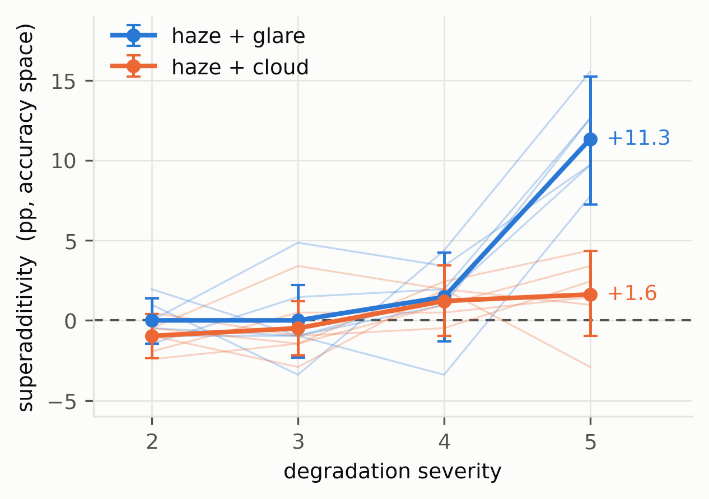
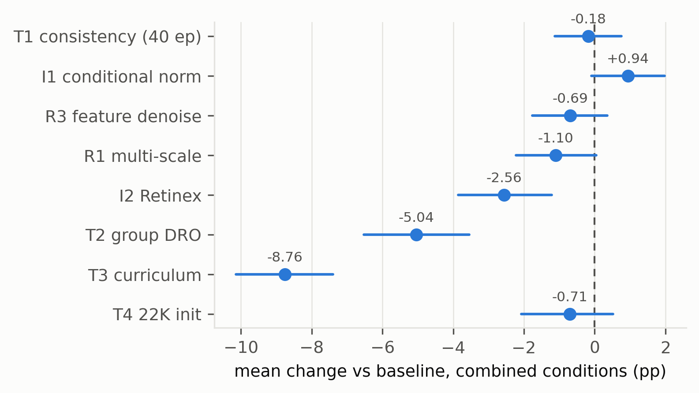

# Compound Weather Degradations in Maritime Ship-Type Recognition: A Paired Evaluation Protocol and a Severity Threshold for Superadditivity

*Draft — 2026-10-30. Every number in this draft is traceable to a file listed in `reports/snapshot.json`.*

---

## Abstract

Maritime images are rarely degraded by one factor at a time: haze, cloud cover and sun glare co-occur, and operational recognition systems meet them in combination. Existing maritime robustness studies nonetheless vary one degradation at a time. We introduce a paired evaluation protocol for compound degradations and apply it to fine-grained ship-type recognition on FGSC-23 (eight civilian classes). The protocol fixes the preprocessing pipeline, derives the corruption instance for every image from a deterministic function of the image identity, and evaluates all conditions per image, so that any two models — or any two conditions — can be differenced without confounding. Using four backbone families we find that compound conditions produce accuracy drops of up to 43 percentage points and that these drops are not a linear function of the single-factor drops. Studying the severity axis with a pre-registered four-point design, we locate the phenomenon precisely: at severities 2–4 the observed compound drop is statistically indistinguishable from the additive prediction (all confidence intervals cover zero), whereas at severity 5 the compound drop exceeds the additive prediction by **+11.3 pp (95% CI [+7.2, +15.3], BH q < 0.001)** and exceeds the largest drop any single degradation produces in **6 of 6** runs. Per-image analysis shows these are not merely harder instances of the same errors: **41.5%** of the errors made under the severe compound condition are made by no single degradation at any severity — within the three families, five severities and two domains tested, at the same model and seed. Pixel statistics explain much of the severity-5 drop at the condition level (saturation and contrast, R² = 0.80) but only weakly per image (r = 0.13, 0.26); the two tests derived from that reading both fail to support it as the mechanism: a soft-shoulder re-render removes about a third of the excess-over-additive, and a clipped-pixel mask input yields no accuracy gain. Finally, we report a pre-registered negative result: seven single-point interventions — input conditioning, Retinex preprocessing, multi-scale fusion, feature denoising, consistency training, group DRO and curriculum training — plus an ImageNet-22K initialization control, none improves on a strong combined-augmentation baseline after full training. We analyse why, and we report one methodological artefact that matters beyond this task: a +1.66 pp gain measured at a 24-epoch screening budget disappears (−0.18 pp) when the same candidate is trained to 40 epochs. We release the protocol, the paired evaluation harness, all checkpoints and a hash manifest that reproduces the published numbers bit-exactly.

**Keywords:** maritime computer vision; ship classification; robustness evaluation; compound degradations; superadditivity; negative results

---

## 1. Introduction

A ship photographed from shore in the Yellow Sea is not degraded by either haze or glare; it is degraded by some mixture of both, on top of an unknown amount of cloud. Recognition models deployed on such imagery are therefore evaluated under conditions that no single-corruption benchmark represents.

The published maritime literature has moved in the opposite direction. FoggySea isolates sea fog. SeaCloud-Ship isolates cloud occlusion. Studies of haze on warship classification isolate haze. Benchmarks that do consider multiple corruptions — ImageNet-C and its descendants — hold the number of *types* at one and vary only severity. Recent general-vision work studies composition, but typically at the level of "two or more corruptions applied in sequence", without decomposing the joint effect against the marginal effects of its parts. As far as we can establish, no maritime study reports how a compound degradation compares to its constituents, and no study in any domain reports an explicit factorial decomposition of accuracy loss on ship-type recognition.

We therefore ask a narrower question than "how robust are ship classifiers": **what does a compound degradation do that its constituents do not, and how does that difference depend on severity?**

Answering it required three design decisions that turned out to matter more than any model:

1. **Paired corruption.** The corruption parameters for an image are drawn from `stable_seed(recipe_version, sample_id, role, kind, severity, domain)`. Two models evaluated on the same condition see the identical corrupted image; two conditions evaluated on the same model differ only in the degradation. This turns every model comparison into a paired comparison and removes most of the seed noise that otherwise dominates at 157 validation images.
2. **Pre-registered screening with full-budget confirmation.** Screening statistics were fixed before training. The protocol's value is shown by the fact that it caught its own artefact: a candidate that looked like +1.66 pp at a 24-epoch budget was −0.18 pp at 40 epochs.
3. **Analysis of stored predictions, not just aggregates.** Every condition's per-image prediction is archived, which lets us ask questions that aggregate accuracies cannot answer — in particular whether compound failures are the same failures a single degradation makes.

**Contributions.**

- A paired protocol for compound-degradation evaluation in maritime recognition, with a strong combined-augmentation baseline, group-disjoint folds and cluster bootstrap inference (§3).
- Evidence that the effect of compound degradation is **not** separable into its constituents, and that this non-separability is a **threshold phenomenon confined to the highest severity** rather than a smooth gradient (§4.3) — including one pre-registered prediction that failed.
- Evidence that compound failures are qualitatively new: 41.5% of severe-compound errors occur on images that every single degradation leaves correct (§4.4).
- A pre-registered negative result on eight interventions, and a documented case in which a limited training budget manufactures a gain (§5).

---

## 2. Related work

**Maritime datasets and degradation studies.** FGSC-23 provides fine-grained ship classes; the civilian subset used here has eight classes. FoggySea (Ocean Engineering, 2026) benchmarks detectors on synthetically fogged SeaShips. SeaCloud-Ship (Frontiers in Remote Sensing, 2025) studies few-shot ship classification under cloud occlusion at controlled coverage. A recent study of FGSC-23 under synthetic cloud (WAVES) reports uncertainty behaviour, not compound effects. Work on haze and warship classification reports monotone accuracy decay with fog density. All of these vary one factor.

**Corruption benchmarks.** ImageNet-C (ICLR 2019) established 15 corruption types × 5 severities with the mean corruption error (mCE) as the summary statistic; by construction it never combines types. ImageNet-3DCC (CVPR 2022) renders physically motivated corruptions but still one at a time. Mintun et al. (NeurIPS 2021) showed that augmentation-derived robustness is corruption-specific and that mCE can be gamed by similarity — a warning we take seriously and address by never tuning augmentation to the evaluation corruptions.

**Composition.** Two-factor perturbation studies (arXiv 2203.01323, 2022) report that a second factor sometimes *helps*. Compositional robustness work (Modularity Trumps Invariance, 2023) stacks 2–6 corruptions and argues invariance does not transfer. Decision-boundary analyses of combined corruptions (ICIICE 2026) examine which combinations break robustness. None of these decomposes the joint effect against the product of marginals, which is precisely the quantity that distinguishes "harder" from "different".

**Negative results as method.** DomainBed (ICLR 2021) and RDumb (NeurIPS 2023) established that careful, well-controlled benchmarks often find simple baselines unbeaten. We follow that tradition rather than claiming an algorithmic contribution we do not have.

---

## 3. Protocol

**Data.** FGSC-23, civilian scope, eight classes. 618 training and 157 validation images. Three group-disjoint folds over the training set (412/206 per fold), split by `source_group_id` so that no vessel or scene appears in both sides. The 236 images in the dataset's `test` split are **not** used for any result in this paper and are disclosed as compromised as a blind set (§7.3).

**Preprocessing.** Frozen: `ImageOps.contain(image, (224, 224), BICUBIC)` → corruption → `ImageOps.pad((224, 224), color=(124, 116, 104))` → ImageNet normalization (mean [.485, .456, .406], std [.229, .224, .225]). No augmentation touches evaluation images.

**Corruptions.** Three physical families — haze (atmospheric transmission with random airlight), cloud (soft spatial support with alpha blending), glare (Gaussian bloom with gain) — each at five severities, implemented in `degradations.py` and frozen with a recipe hash recorded in every run. Compound kinds apply both components with independent random fields. Two domains: `matched` (fields drawn at the same scale as the scene) and `shifted` (fields drawn at a different scale, a stricter domain-shift control). 43 conditions are evaluated per model: clean, 30 single, 12 compound, plus one placement diagnostic.

**Training.** ConvNeXt-T (torchvision ImageNet-1K weights, 27.8M parameters), batch 32, 40 epochs, cosine schedule, and a combined augmentation recipe that samples clean in 25% of batches, single degradations in 50% and compounds in 25%, with severities drawn from the recipe's own distribution. Two seeds (17, 29) per fold.

**Inference.** Cluster bootstrap over `source_group_id`, 2000–4000 resamples, with the two seeds of an image kept in the same cluster. Multiplicity controlled by Benjamini–Hochberg where a family of tests is reported. All gains are computed per image, same fold, same seed, same corruption instance.

**Total cost.** 128 training runs, ≈3.3 GPU-hours on a single RTX 4090.

---

## 4. Results

### 4.1 Single degradations are unequal, and haze is nearly harmless

On the baseline arm, clean accuracy is 84.5%. At severity 5, matched haze costs 3.1 pp on average (1.9–4.4 across runs), matched cloud 3.9 pp (2.4–5.8), and matched glare 11.3 pp (9.2–17.5). This asymmetry matters for the interpretation of every compound result below: a "haze + glare" compound is in practice a strong degradation with a weak one added, and haze alone is nearly harmless at every severity we tested.

### 4.2 Compound degradations drop accuracy far below their constituents

*Figure 1. Accuracy drop (pp) of each compound condition against the largest drop produced by any severity of either constituent, baseline arm, mean over 3 folds × 2 seeds.*

At severity 5, haze+glare drops accuracy by 25.7 pp and haze+cloud by 8.6 pp, against largest single drops of 11.3 and 4.0 pp respectively. Across four backbone families the same condition (`matched_haze+glare_5`) produces drops between −26.1 and −43.3 pp; nine conditions have a mean drop of at least 5 pp with a confidence interval excluding zero in all four families. The compound effect is therefore not a property of one architecture.

### 4.3 Superadditivity appears at severity 5 only — a threshold, not a gradient

We define superadditivity in accuracy space as

E(s) = [acc(clean) − acc(a+b, s)] − {[acc(clean) − acc(a, s)] + [acc(clean) − acc(b, s)]},

so that E(s) is the share of the compound drop not explained by the two marginal drops. The additive baseline is the sum of those two marginals, each measured on the same images, same model, same seed, at the same severity, in the same domain as the compound; E(s) is what the sum leaves unexplained. Because a reviewer can reasonably object that any such measure is an artefact of the metric, we report it in accuracy space (the margin-space version appears in the appendix and agrees in sign).

*Figure 2. Superadditivity E(s) with 95% cluster-bootstrap intervals (heavy lines) and the six individual (fold, seed) runs (thin lines). Baseline arm.*

| Severity | haze+glare E | 95% CI | haze+cloud E | 95% CI |
|---|---|---|---|---|
| 2 | 0.00 | [−1.45, +1.38] | −0.97 | [−2.36, +0.41] |
| 3 | 0.00 | [−2.34, +2.20] | −0.49 | [−2.20, +1.21] |
| 4 | +1.46 | [−1.30, +4.24] | +1.21 | [−0.98, +3.42] |
| 5 | **+11.33** | **[+7.22, +15.22]** | +1.62 | [−0.97, +4.33] |

Only haze+glare at severity 5 survives Benjamini–Hochberg correction over the eight estimates (q < 0.001); all others have q ≥ 0.48.

We pre-registered four predictions before running severities 2 and 4. Two are confirmed, one is confirmed and one **failed**:

- P2 (E at severity 2 covers zero): **confirmed**.
- P3 (lower CI bound at severity 5 exceeds 2 pp): **confirmed** ([+7.22]).
- P4 (novelty share increases with severity): **confirmed** (3.8% → 6.6% → 19.1% → 41.5%).
- P1 (E increases monotonically with severity in at least five of six runs): **failed — 2/6**. The pooled mean is ordered, but the run-to-run noise (−3.4 to +4.9 pp at severities 2–4) exceeds the difference between adjacent severities.

We report P1's failure rather than redefining the test, because it changes the claim: the data do not support "superadditivity grows with severity". They support a sharper statement: **at severities 2–4 the compound effect is additive, and at severity 5 it is not.** In all six runs, E(5) exceeds every E(s ≤ 4) of the same run. With no point at severity 4.5, the crossover lies between 4 and 5 and cannot be localised further.

### 4.4 Compound failures are new failures

For each compound condition we ask, per image and per seed: is this image misclassified under the compound, and is it also misclassified under *any* severity of either constituent?

| Condition | compound errors | error under no single at any severity | share |
|---|---:|---:|---:|
| haze+glare, s=2 | 213 | 8 | 3.8% |
| haze+glare, s=3 | 241 | 16 | 6.6% |
| haze+glare, s=4 | 298 | 57 | 19.1% |
| haze+glare, s=5 | 504 | 209 | **41.5%** |
| haze+cloud, s=2 | 207 | 2 | 1.0% |
| haze+cloud, s=3 | 217 | 12 | 5.5% |
| haze+cloud, s=4 | 237 | 17 | 7.2% |
| haze+cloud, s=5 | 292 | 67 | 22.9% |

Error counts are per (fold, seed) evaluation, summed over the six runs; they share images across seeds and are descriptive, not independent observations. For the severity-3 and severity-5 conditions we additionally compute the overlap with the strongest single condition: 73.4% and 44.4% respectively for haze+glare (`reports/COMPOUND_ANALYSIS.md`).

At severity 5, four in ten compound errors are errors that no single degradation produces on that image — not even the strongest one, not at any severity. **Scope of that statement:** it is bounded by the comparison set actually run — three degradation families × five severities × two domains, the same model, the same seed, the same image. It does not claim that no conceivable single degradation could produce them; an untested family, an intermediate severity or a different corruption implementation lies outside the comparison. The phenomenon cannot be explained by saying the compound is simply more severe: there is no single degradation of comparable severity to compare against, since the compound drop (25.7 pp) exceeds the largest single drop (11.3 pp) in all six runs.

This is a behavioural analysis, not a mechanistic one. It does not say *why* the combination produces new errors; candidate mechanisms — feature loss at the transition between two degradation fields, attention displacement by the glare point source under haze, class-boundary motion — are untested.

### 4.5 Clean accuracy does not rank models under compound degradation

Two observations in the intervention study (§5) point the same way. The curriculum candidate achieved the highest clean accuracy of any candidate (85.1%) and the worst compound accuracy (67.3%). The ImageNet-22K initialization improved clean accuracy by +0.73 pp while reducing compound accuracy by −0.71 pp. Neither result is significant on its own, but together they caution against selecting models by clean validation accuracy when deployment is under weather.

### 4.6 Where the excess comes from: two probes and their limits

The first probe measures the degradation pipeline itself, not the model. Over the 23 `matched` conditions (three single families × five severities, two compounds × four severities), haze+glare at severity 5 saturates 60.2% of pixels (any channel ≥ 0.99) against 38% for the most saturated single condition (glare_5), and is the only condition that combines high saturation with low contrast (luminance s.d. 0.094). Fitting the condition-level drop as a two-parameter function of saturation fraction and contrast over those 23 conditions gives **R² = 0.80** (coefficients +30.7 / −16.7 pp); adding an interaction term raises it only to 0.814. Two boundaries apply. It is a **condition-level** relation: at the per-image level the correlation between an image's saturation fraction and its being misclassified is only 0.13 and 0.26 (two seeds). And it is incomplete: haze+cloud at severity 5 saturates nothing, still exceeds the additive prediction, and is the largest residual of the fit (≈6 pp).

The second probe asks whether hard highlight clipping — the mechanism the first probe points at — is what produces the excess. Everything is recomposed as `corrupt()` does, except that the highlight is rolled off softly above 0.7 instead of clipped at 1.0, and the marginal drops used in the additive prediction are measured in the same re-rendered world. Under clipping the excess at haze+glare_5 is +9.7 pp, under the soft shoulder +6.3 pp (saturation 60.2% → 40.7%). Roughly a third of the excess is attributable to hard clipping; the rest survives without it. This is a single fold and seed on the baseline arm, so it is a directional result, not an estimate.

The third test turns the same reading into a model change and fails: a fourth input channel marking pixels clipped in any channel (zero-initialised mask stem, censored-evidence pooling, +1536 parameters), trained on exactly the baseline recipe and scored on the same 43 paired conditions with per-image McNemar, moves compound accuracy by +0.61 pp (p = 0.43, seed 17) and +0.97 pp (p = 0.27, seed 29), costs single-degradation accuracy (−0.47 pp, p = 0.046; −0.29 pp, p = 0.41), and changes sign between seeds on the worst compound condition (−1.9 / +5.8 pp). Telling the network which pixels are censored does not help it.

Together the three probes support one statement only: saturation and contrast are a good description of the severity-5 drop **at the level of conditions**, and a poor one of which images fail. We do not claim a mechanism for the new errors.

---

## 5. Interventions: a pre-registered negative result

We screened seven interventions across three loci plus one initialization control. Every candidate was trained at 40 epochs, three folds, two seeds, with identical data, preprocessing, corruption instances and evaluation. Screening criteria were fixed in advance: a mean gain ≥ +1.5 pp on the combined conditions, at least two of three folds positive, no clean-accuracy loss beyond 1 pp, and a paired bootstrap interval excluding zero.

*Figure 3. Mean change (pp) against the baseline on the eight combined conditions, with 95% cluster-bootstrap intervals.*

| Candidate | Locus | Mean Δ | 95% CI | Verdict |
|---|---|---:|---|---|
| T1 consistency training | training | −0.18 | [−1.13, +0.76] | not sustained |
| I1 conditional normalization | input | +0.94 | [−0.09, +1.98] | below criterion |
| R3 feature denoising | representation | −0.69 | [−1.76, +0.35] | no positive evidence |
| R1 multi-scale fusion | representation | −1.10 | [−2.23, +0.05] | interval covers zero |
| I2 Retinex preprocessing | input | −2.56 | [−3.86, −1.22] | negative |
| T2 group DRO | training | −5.04 | [−6.52, −3.54] | negative |
| T3 curriculum | training | −8.76 | [−10.14, −7.40] | negative |
| T4 ImageNet-22K init | initialization | −0.71 | [−2.07, +0.52] | no advantage demonstrated |

Two caveats we insist on. First, R1's interval covers zero: the correct statement is "no detectable gain at +4% parameters and +8.5% latency", not "significant harm". Second, T4 compares two specific weight sets, not "pretraining quality" as a factor.

**The budget artefact.** T1 showed +1.66 pp [0.63, 2.68] when screened at 24 epochs and −0.18 pp [−1.13, 0.76] at 40 epochs. Both arms improved with the longer budget (84.5 → 85.7 and 84.0 → 85.1 macro-F1), and the candidate's apparent advantage was the difference between two convergence trajectories. Any screening pipeline that compares candidates at a truncated budget inherits this risk; our protocol's full-budget confirmation is what caught it.

**Error-flow analysis.** Across 6 (fold, seed) pairs × 8 conditions × 206 images, every candidate fixes some baseline errors and breaks more: R1 620 fixed / 728 broken, I2 639/904, T2 608/1103, T3 547/1415. These counts are not independent observations (the same image recurs across conditions and seeds) and are used only to describe direction; formal inference remains the clustered bootstrap.

---

## 6. Real imagery: observational only

On 157 FGSC-23 validation images annotated for the presence of real degradation (93 with at least one), the difference in accuracy between degraded and clean groups is −2.3 pp with a seed interval of [−7.8, +4.3]. On 184 two-class FGSRCS development crops the difference is +1.8 pp. Neither supports a claim that real degradation degrades accuracy in this setting, and neither can, because the heavy-degradation stratum contains at most two images. We report these numbers to bound what we claim: our findings concern the synthetic protocol, and we make no claim about their transfer to real weather.

---

## 7. Discussion and limitations

### 7.1 What this work supports

- Under a fixed data set, training recipe and evaluation pipeline, compound degradations are not additive at the highest severity: the joint drop exceeds the sum of marginal drops by 11.3 pp, and exceeds the largest single-degradation drop in every run.
- A substantial share of severe-compound errors (41.5%) cannot be produced by any single degradation, which rules out the "just harder" explanation at the level of behaviour.
- Seven mechanism-diverse single-point interventions and one initialization control do not beat a strong combined-augmentation baseline. The negative result is pre-registered and reproducible.

### 7.2 What it does not support

- **No performance ceiling.** Frequency-domain methods were not tested; deeper backbones, larger data and multi-factor interventions were not tested. We tested seven single-point changes and found no gain; that is all.
- **No mechanism.** The novelty analysis is behavioural. The saturation/contrast fit of §4.6 is a condition-level association (R² = 0.80) with weak per-image correlation (r = 0.13, 0.26) and is not evidence of per-image causation. Both mechanism tests derived from it are negative or partial: removing hard clipping removes about a third of the excess, and a clipped-pixel mask gives no gain. The mechanism behind new errors is unknown.
- **No established threshold.** "Threshold" is an inference from four severity levels, not a localised boundary. E is indistinguishable from its additive prediction at 2, 3 and 4 and large at 5, but with no point at 4.5 the crossover is only bounded to (4, 5); our own pre-registered monotonicity prediction failed (2 of 6 runs). The supported claim is the descriptive one, not a law of the severity axis.
- **No generalization to real weather.** §6 is observational with insufficient heavy-degradation samples.
- **No monotone severity law.** Our own pre-registered prediction of monotonicity failed (P1, 2/6); the supported claim is the severity-5 jump.

### 7.3 Data disclosure

The 236 images in FGSC-23's `test` split were used by three diagnostic analyses on 2026-10-29 (part occlusion, local recovery, restoration probe). They were not used in training or in any number reported here, but they are **no longer an unseen test set**, and this paper does not describe them as one. All reported statistics come from folds constructed inside the training split.

### 7.4 Threats to validity

Single dataset; 618 training images; one corruption implementation per family; two seeds; a five-level severity scale with no point between 4 and 5. The cluster bootstrap accounts for the two seeds per image but not for multiplicity across the full condition grid. The pixel-statistics probe is condition-level and the HDR re-render probe is one fold and one seed, so neither carries an interval. No result here is on an unseen test set (§7.3).

---

## 8. Conclusion

Compound weather degradations do something to maritime ship classifiers that single degradations do not: at the highest tested severity their joint effect exceeds the additive prediction by 11.3 pp and exceeds what any single degradation can do, and 41.5% of the resulting errors are errors no single degradation produces. At moderate severities the same conditions are additive. Eight interventions failed to improve on a strong combined-augmentation baseline. The protocol, the predictions, the failed pre-registered test and the negative results are released together, so that the negative half of this paper is as checkable as the positive half.

---

## Appendix A. Reproduction

Every number in this draft is produced by code in `scripts/` from artefacts hashed in `reports/snapshot.json` (140 runs, code, configs, splits, reports). The probes of §4.6 are `reports/SATURATION_PROBE.md` (pixel statistics), `reports/hdr_render_probe.json` (soft-shoulder re-render, script `scripts/hdr_render_probe.py`) and `reports/M1_KILL_TEST.md` (mask falsification, script `scripts/m1_eval.py`, per-image predictions in `reports/m1_preds_s{17,29}.npz`). A full re-evaluation of 12 runs reproduced the published R1 statistic bit-exactly (max absolute difference 0). The pre-registration for the severity 2/4 extension is in `reports/PREREG_SEVERITY_2_4.md`; the analysis and its comparison against the registered predictions is in `reports/SEVERITY_CURVE.md`.

## Appendix B. Margin-space superadditivity

The original analysis measured superadditivity in margin space (difference between compound accuracy and the additive expectation of margin losses): haze+glare extra margin loss −0.152 … −0.032, haze+cloud −0.144 … +0.009, across four backbone families. It agrees in sign with the accuracy-space result reported in §4.3 and is not used for inference here.
