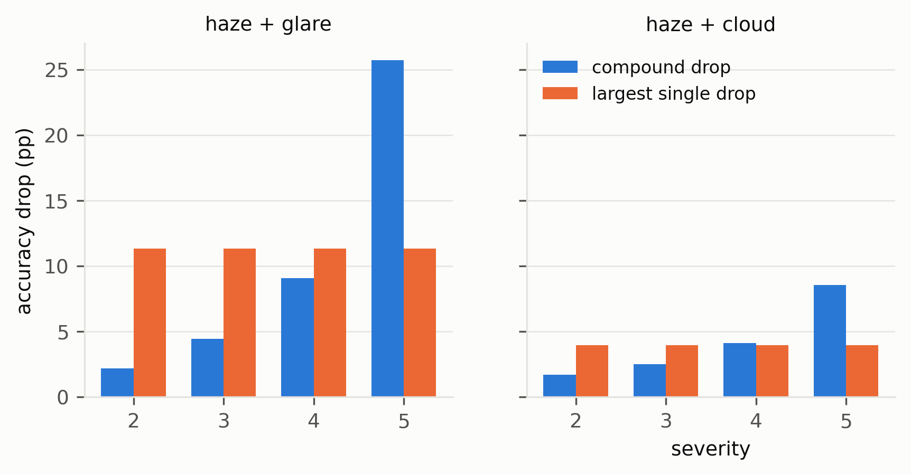
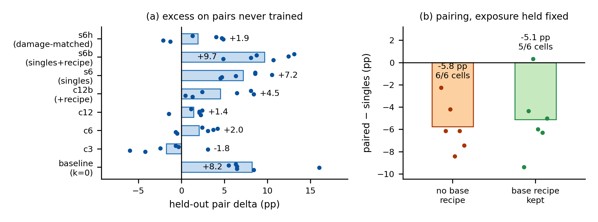

# Compound Weather Degradations in Maritime Ship-Type Recognition: A Paired Evaluation Protocol and a Severity Threshold for Superadditivity

*Draft — 2026-10-30. Every number in this draft is traceable to a file listed in `reports/snapshot.json`.*

---

## Abstract

Maritime images are rarely degraded by one factor at a time: haze, cloud and sun glare co-occur, yet maritime robustness studies vary one degradation at a time. We introduce a paired evaluation protocol for compound degradations, applied to fine-grained ship-type recognition on FGSC-23 (eight civilian classes): preprocessing is fixed, each image's corruption instance is a deterministic function of its identity, and every condition is evaluated per image, so any two models — or conditions — can be differenced without confounding. Four backbone families show compound conditions dropping accuracy by up to 43 points, non-linearly in the single-factor drops. In a pre-registered four-severity design, the compound drop is indistinguishable from its additive prediction at severities 2–4, but at severity 5 it exceeds that prediction by **+11.3 pp (95% CI [+7.2, +15.3], BH q < 0.001)** and exceeds the largest single-degradation drop in **6 of 6** runs. Against the stronger baseline — the union of the constituents' error sets — **41.5%** of severe-compound errors are made by no single degradation at any severity.

We then ask what removes the excess. Training on calibrated compound samples from six families reduces the excess on three pairs held out of every pool from **+8.2 pp to −1.8 pp** (clean accuracy 84.95% → 86.25%); a control showing the model the same six families one at a time, at the same rate and budget, stays at +7.2 pp (paired-minus-singles **−5.8 pp, 6 of 6 cells**). An arm matched on per-image damage recovers about 60% of the gain, so the accounting is roughly 60% under-matched damage and 40% co-occurrence; the co-occurrence part survives matching (**−3.7 pp, 6 of 6**) and is what transfers to unseen pairs. Neither part transfers to families absent from all pools, as pre-registered. Eight single-point interventions (seven mechanisms plus an initialization control) do not beat a strong combined-augmentation baseline, and we document one artefact that matters beyond this task: a +1.66 pp gain at a 24-epoch screening budget becomes −0.18 pp at 40 epochs. We release the protocol, harness, checkpoints and a manifest that reproduces every number.

**Keywords:** maritime computer vision; ship classification; robustness evaluation; compound degradations; superadditivity; negative results

---

## 1. Introduction

A ship photographed from shore in the Yellow Sea is not degraded by either haze or glare; it is degraded by some mixture of both, on top of an unknown amount of cloud. Recognition models deployed on such imagery are therefore evaluated under conditions that no single-corruption benchmark represents.

The published maritime literature has moved in the opposite direction. FoggySea isolates sea fog [@yang2026foggysea], CARP isolates cloud occlusion [@zhan2025carp], and studies of haze on warship classification isolate haze. Benchmarks that do consider multiple corruptions — ImageNet-C [@hendrycks2019imagenetc] and its descendants — hold the number of *types* at one and vary only severity. Recent general-vision work studies composition as "two or more corruptions applied in sequence", without decomposing the joint effect against the marginals of its parts. As far as we can establish, no maritime study reports how a compound degradation compares to its constituents, and no study in any domain reports an explicit factorial decomposition of accuracy loss on ship-type recognition.

We therefore ask a narrower question than "how robust are ship classifiers": **what does a compound degradation do that its constituents do not, and how does that difference depend on severity?**

Answering it required three design decisions that turned out to matter more than any model:

1. **Paired corruption.** The corruption parameters for an image are drawn from `stable_seed(recipe_version, sample_id, role, kind, severity, domain)`. Two models evaluated on the same condition see the identical corrupted image; two conditions evaluated on the same model differ only in the degradation. This turns every model comparison into a paired comparison and removes most of the seed noise that otherwise dominates at 157 validation images.
2. **Pre-registered screening with full-budget confirmation.** Screening statistics were fixed before training. The protocol's value is shown by the fact that it caught its own artefact: a candidate that looked like +1.66 pp at a 24-epoch budget was −0.18 pp at 40 epochs.
3. **Analysis of stored predictions, not just aggregates.** Every condition's per-image prediction is archived, which lets us ask questions that aggregate accuracies cannot answer — in particular whether compound failures are the same failures a single degradation makes.

**Contributions.**

- A paired protocol for compound-degradation evaluation in maritime recognition, with a strong combined-augmentation baseline, group-disjoint folds and cluster bootstrap inference (§3).
- Evidence that the effect of compound degradation is **not** separable into its constituents, and that under the shipped renderer this non-separability appears as a **threshold confined to the highest severity** rather than a smooth gradient (§4.3) — including one pre-registered prediction that failed. A second, physically-motivated renderer, applied both to a frozen model and to models retrained under it, reproduces the severity-5 excess (10.2 / 16.0 pp against 9.7 / 12.6 pp) but produces it from severity 4 upwards: the excess is not an artefact of one rendering, while the *onset severity* is (§8.4).
- Evidence that compound failures are qualitatively new: 41.5% of severe-compound errors occur on images that every single degradation leaves correct (§4.4). Against the stronger independent-failure baseline (the union of single-corruption error sets), the severity-5 haze+glare excess survives in 6/6 cells (+7.3 to +13.1 pp, mean +9.9), while the haze+cloud excess vanishes (mean −0.7 pp); at severities 2–4 both pairs are mildly sub-additive (§4.6).
- A composition study over fifteen calibrated pairs: at matched marginal damage the interaction decomposes additively into per-family main effects (R² 0.42–0.90 across two backbones and twelve cells), no single-corruption geometric predictor recovers the ordering, and the per-family values themselves are backbone-dependent (§4.6).
- Evidence that the excess is what an uncovered operating point looks like, and that it is removable: a pool of calibrated compound samples cuts the held-out excess from +8.2 pp to −1.8 pp (6/6 cells), the same six families applied one at a time do not (−5.8 pp paired difference, 6/6), roughly 40% of the gain survives an arm matched on per-image damage (−3.7 pp, 6/6), and the effect transfers to unseen pairs but not to unseen families (§5).
- A pre-registered negative result on eight interventions, and a documented case in which a limited training budget manufactures a gain (§6).

---

## 2. Related work

**Maritime datasets and degradation studies.** FGSC-23 [@zhang2020fgsc23] provides fine-grained ship classes; the civilian subset used here has eight classes. FoggySea [@yang2026foggysea] benchmarks detectors on synthetically fogged SeaShips. CARP [@zhan2025carp] studies few-shot ship classification under cloud occlusion at controlled coverage. A recent study of FGSC-23 under synthetic cloud [@manca2026waves] reports uncertainty behaviour, not compound effects. Work on haze and warship classification reports monotone accuracy decay with fog density [@yang2026foggysea]. All of these vary one factor.

**Corruption benchmarks.** ImageNet-C [@hendrycks2019imagenetc] established 15 corruption types × 5 severities with the mean corruption error (mCE) as the summary statistic; by construction it never combines types. ImageNet-3DCC [@kar20223dcc] renders physically motivated corruptions but still one at a time. Mintun et al. [@mintun2021augcorruption] showed that augmentation-derived robustness is corruption-specific and that mCE can be gamed by similarity — a warning we take seriously and address by never tuning augmentation to the evaluation corruptions.

**Composition.** Two-factor perturbation studies [@dai2022twofactor] report that a second factor sometimes *helps*; compositional robustness work [@mason2023modularity] stacks 2–6 corruptions and argues invariance does not transfer; decision-boundary analyses [@wang2026realboundary] examine which combinations break robustness. None decomposes the joint effect against the product of marginals — the quantity that distinguishes "harder" from "different".

**Negative results as method.** DomainBed [@gulrajani2021domainbed] and RDumb [@press2023rdumb] established that careful, well-controlled benchmarks often find simple baselines unbeaten. We follow that tradition rather than claiming an algorithmic contribution we do not have.

---

## 3. Protocol

**Data.** FGSC-23 [@zhang2020fgsc23], civilian scope, eight classes. 618 training and 157 validation images. Three group-disjoint folds over the training set (412/206 per fold), split by `source_group_id` so that no vessel or scene appears in both sides. The 236 images in the dataset's `test` split are **not** used for any result in this paper and are disclosed as compromised as a blind set (§8.3).

**Preprocessing.** Frozen: `ImageOps.contain(image, (224, 224), BICUBIC)` → corruption → `ImageOps.pad((224, 224), color=(124, 116, 104))` → ImageNet normalization (mean [.485, .456, .406], std [.229, .224, .225]). No augmentation touches evaluation images.

**Corruptions.** Three physical families — haze (atmospheric transmission with random airlight), cloud (soft spatial support with alpha blending), glare (Gaussian bloom with gain) — each at five severities, implemented in `degradations.py` and frozen with a recipe hash recorded in every run. Compound kinds apply both components with independent random fields. Two domains: `matched` (fields drawn at the same scale as the scene) and `shifted` (fields drawn at a different scale, a stricter domain-shift control). 43 conditions are evaluated per model: clean, 30 single, 12 compound, plus one placement diagnostic.

**Training.** ConvNeXt-T [@liu2022convnext] (torchvision ImageNet-1K weights, 27.8M parameters), batch 32, 40 epochs, cosine schedule, and a combined augmentation recipe that samples clean in 25% of batches, single degradations in 50% and compounds in 25%, with severities drawn from the recipe's own distribution. Two seeds (17, 29) per fold.

**Inference.** Cluster bootstrap over `source_group_id`, 2000–4000 resamples, with the two seeds of an image kept in the same cluster. Multiplicity controlled by Benjamini–Hochberg where a family of tests is reported. All gains are computed per image, same fold, same seed, same corruption instance.

**Total cost.** 136 training runs, ≈3.5 GPU-hours on a single RTX 4090.

---

## 4. Results

### 4.1 Single degradations are unequal, and haze is nearly harmless

On the baseline arm, clean accuracy is 84.5%. At severity 5, matched haze costs 3.1 pp on average (1.9–4.4 across runs), matched cloud 3.9 pp (2.4–5.8), and matched glare 11.3 pp (9.2–17.5). This asymmetry matters for the interpretation of every compound result below: a "haze + glare" compound is in practice a strong degradation with a weak one added, and haze alone is nearly harmless at every severity we tested.

### 4.2 Compound degradations drop accuracy far below their constituents

*Figure 1. Accuracy drop (pp) of each compound condition against the largest drop produced by any severity of either constituent, baseline arm, mean over 3 folds × 2 seeds.*

At severity 5, haze+glare drops accuracy by 25.7 pp and haze+cloud by 8.6 pp, against largest single drops of 11.3 and 4.0 pp respectively. Across four backbone families the same condition (`matched_haze+glare_5`) produces drops between −26.1 and −43.3 pp; nine conditions have a mean drop of at least 5 pp with a confidence interval excluding zero in all four families. The compound effect is therefore not a property of one architecture.

### 4.3 Superadditivity appears at severity 5 only — a threshold, not a gradient

We define superadditivity in accuracy space as

E(s) = [acc(clean) − acc(a+b, s)] − {[acc(clean) − acc(a, s)] + [acc(clean) − acc(b, s)]},

so that E(s) is the share of the compound drop not explained by the two marginal drops. The additive baseline is the sum of those two marginals, each measured on the same images, same model, same seed, at the same severity, in the same domain as the compound; E(s) is what the sum leaves unexplained. Because a reviewer can reasonably object that any such measure is an artefact of the metric, we report it in accuracy space (the margin-space version appears in the appendix and agrees in sign).

| Severity | haze+glare E | 95% CI | haze+cloud E | 95% CI |
|---|---|---|---|---|
| 2 | 0.00 | [−1.45, +1.38] | −0.97 | [−2.36, +0.41] |
| 3 | 0.00 | [−2.34, +2.20] | −0.49 | [−2.20, +1.21] |
| 4 | +1.46 | [−1.30, +4.24] | +1.21 | [−0.98, +3.42] |
| 5 | **+11.33** | **[+7.22, +15.22]** | +1.62 | [−0.97, +4.33] |

Only haze+glare at severity 5 survives Benjamini–Hochberg correction over the eight estimates (q < 0.001); all others have q ≥ 0.48.

We pre-registered four predictions before running severities 2 and 4. Three are confirmed and one **failed**; per-run values are in `reports/COMPOUND_ANALYSIS.md`:

- P2 (E at severity 2 covers zero): **confirmed**.
- P3 (lower CI bound at severity 5 exceeds 2 pp): **confirmed** ([+7.22]).
- P4 (novelty share increases with severity): **confirmed** (3.8% → 6.6% → 19.1% → 41.5%).
- P1 (E increases monotonically with severity in at least five of six runs): **failed — 2/6**. The pooled mean is ordered, but the run-to-run noise (−3.4 to +4.9 pp at severities 2–4) exceeds the difference between adjacent severities.

We report P1's failure rather than redefining the test, because it changes the claim: the data do not support "superadditivity grows with severity". They support a sharper statement: **at severities 2–4 the compound effect is additive, and at severity 5 it is not.** In all six runs, E(5) exceeds every E(s ≤ 4) of the same run. With no point at severity 4.5, the crossover lies between 4 and 5 and cannot be localised further.

This statement is scoped to one rendering: under an independent, physically-motivated renderer with severity matched on transmission and saturated-pixel fraction, the severity-5 excess is preserved but its onset moves to severity 4. What survives is the excess and its growth with severity; the onset is a property of the renderer (§8.4, `reports/PHYSICAL_RENDERER.md`).

### 4.4 Compound failures are new failures

For each compound condition we ask, per image and per seed: is this image misclassified under the compound, and is it also misclassified under *any* severity of either constituent?

| Condition | compound errors | error under no single at any severity | share |
|---|---:|---:|---:|
| haze+glare, s=2 | 213 | 8 | 3.8% |
| haze+glare, s=3 | 241 | 16 | 6.6% |
| haze+glare, s=4 | 298 | 57 | 19.1% |
| haze+glare, s=5 | 504 | 209 | **41.5%** |
| haze+cloud, s=2 | 207 | 2 | 1.0% |
| haze+cloud, s=3 | 217 | 12 | 5.5% |
| haze+cloud, s=4 | 237 | 17 | 7.2% |
| haze+cloud, s=5 | 292 | 67 | 22.9% |

Error counts are per (fold, seed) evaluation, summed over the six runs; they share images across seeds and are descriptive, not independent observations. For the severity-3 and severity-5 conditions we additionally compute the overlap with the strongest single condition: 73.4% and 44.4% respectively for haze+glare (`reports/COMPOUND_ANALYSIS.md`).

At severity 5, four in ten compound errors are errors that no single degradation produces on that image — not even the strongest one, at any severity. **Scope:** it is bounded by the comparison set actually run — three families × five severities × two domains, the same model and seed. It does not claim that no conceivable single degradation could produce them. The phenomenon is not explained by the compound being simply more severe: there is no single degradation of comparable severity to compare against, since the compound drop (25.7 pp) exceeds the largest single drop (11.3 pp) in all six runs.

This is a behavioural analysis, not a mechanistic one. It does not say *why* the combination produces new errors; candidate mechanisms — feature loss at the transition between two degradation fields, attention displacement by the glare point source under haze, class-boundary motion — are untested.

### 4.5 Where the excess comes from: two probes and their limits

The first probe measures the degradation pipeline, not the model. Over the 23 `matched` conditions, haze+glare at severity 5 saturates 60.2% of pixels (any channel ≥ 0.99) against 38% for the most saturated single condition (glare_5), and is the only condition combining high saturation with low contrast (luminance s.d. 0.094). Fitting the condition-level drop to saturation fraction and contrast over those 23 conditions gives **R² = 0.80** (+30.7 / −16.7 pp); an interaction term raises it only to 0.814. Two boundaries apply: it is a **condition-level** relation, since per-image correlation between saturation fraction and misclassification is only 0.13 and 0.26 (two seeds); and it is incomplete, since haze+cloud at severity 5 saturates nothing, still exceeds the additive prediction and is the largest residual of the fit (≈6 pp).

The second probe asks whether hard highlight clipping — the mechanism the first probe points at — is what produces the excess. Everything is recomposed as `corrupt()` does, except that the highlight is rolled off softly above 0.7 instead of clipped at 1.0, and the marginal drops used in the additive prediction are measured in the same re-rendered world. Under clipping the excess at haze+glare_5 is +9.7 pp, under the soft shoulder +6.3 pp (saturation 60.2% → 40.7%). Roughly a third of the excess is attributable to hard clipping; the rest survives without it. This is a single fold and seed on the baseline arm, so it is a directional result, not an estimate.

Turning the reading into a model change fails: a fourth input channel marking clipped pixels in any channel (zero-initialised mask stem, +1536 parameters), trained on the baseline recipe and scored on the same 43 paired conditions, moves compound accuracy by +0.61 pp (p = 0.43) and +0.97 pp (p = 0.27) on the two seeds, costs single-degradation accuracy (−0.47, −0.29 pp) and changes sign between seeds on the worst condition (−1.9 / +5.8 pp). Telling the network which pixels are censored does not help it.

Together the three probes support one statement only: saturation and contrast are a good description of the severity-5 drop **at the level of conditions**, and a poor one of which images fail. We do not claim a mechanism for the new errors.

### 4.6 The interaction is additive over corruption families

Everything above concerns three hand-picked degradations. To ask whether the failure of additivity has structure beyond them, we added six synthetic families (defocus, motion, noise, rain, pixelate, impulse) with continuous levels, calibrated each level so that it alone costs a matched 10 or 20 pp on the frozen baseline, and measured all fifteen pairs over three folds × two seeds.

Raw `E` conflates interaction with error overlap: two degradations that break the same images cannot add up. Against the independent-failure baseline `delta = e(a+b) − |E_a ∪ E_b|`, the severity-5 haze+glare excess survives in all six cells (fold0/1/2 × seed17/29; +7.3 to +13.1 pp, mean +9.9), while haze+cloud falls to −0.7 pp and is positive in only two cells; at severities 2–4 both compounds sit 0.4–2.3 pp *below* the union baseline. The headline result is therefore not an artefact of overlap, but haze+cloud should not be called superadditive.

Across the fifteen added pairs, delta ranges from −4.4 to +18.3 pp (ConvNeXt-T). An additive model in per-family main effects, `delta(a,b) ≈ m_a + m_b`, explains R² = 0.48–0.90 in all six cells, and R² = 0.42–0.75 in all six ResNet-50 cells: which pair fails is largely predicted by which families it contains. The family values themselves do not transfer between backbones (impulse contributes +1.7 pp on ConvNeXt and −8.2 pp on ResNet-50), so superadditivity is a property of a (model, corruption) pair rather than of a corruption pair alone.

No single-corruption geometric predictor recovers the ordering — mean feature-shift cosine, per-image displacement alignment, retained high-frequency energy and per-class error correlation all fail (|ρ| < 0.6 with unstable sign across cells). Predicting which composition will explode requires measuring part of the composition.

A six-cell replication gate fixed before folds 1–2 were run passed four of five criteria on ConvNeXt-T (the failed one, sub-additivity of two low-pass families, held in 4/6 cells); the ResNet-50 study passes all five but was not pre-registered.

### 4.7 The same measurement on a standard corruption benchmark

Everything above rests on one dataset and on corruption families written for this study. The decomposition is a measurement claim, so it has to be checked on a substrate other people use. We therefore repeat it on CIFAR-10-C [@hendrycks2019imagenetc]: the fifteen canonical corruptions at their five published severities, with a ResNet-18 [@he2016resnet] trained on clean CIFAR-10 [@krizhevsky2009cifar] and then evaluated on 601 conditions — clean, 75 single and 525 pair — each on the full 10,000-image test set, with per-image correctness stored so that every decomposition can be recomputed offline. Nothing here is trained for robustness; the reference model sees clean images only, which is the setting the compound-corruption literature measures.

Two quantities are computed per condition. `super = e(a+b) − e(a) − e(b)` is the accuracy-space superadditivity that compound-corruption studies report, built on the additivity of marginal errors. `delta = e(a+b) − |E_a ∪ E_b|` is our union baseline, built on the additivity of error *sets*. They differ by exactly the overlap: `super − delta = |E_a ∩ E_b|`. What the two are compared over is therefore not two methods but two assumptions about what a second corruption does to an error already made.

Because the archive's generator is unseeded, the corruptions cannot be reproduced bit-exactly; port fidelity is instead checked by comparing our model's accuracy on regenerated corruptions against its accuracy on the published ones, and the pre-registered tolerance is 1.0 pp. Five predictions (C1–C5) were frozen before the grid ran, with the specification that a failure of C1 — no positive excess at all — would demote the maritime result to a single-dataset observation.

---

## 5. Coverage: the excess is an operating point training never visits

The union decomposition of §4.6 says what the excess is not: compound images are not merely harder instances of the errors single degradations already cause. This section asks what removes it, under a deliberately unglamorous hypothesis — a model can only learn a joint operating point if training shows it one. Under the project's combined recipe, compounds are a quarter of the batches and are drawn from three families (haze, cloud, glare); the fifteen-pair lattice of §4.6 uses six families that training never mixes. If the excess is an uncovered operating point rather than an intrinsic property of compound degradation, teaching the model co-occurrence should remove it — and teaching it the same families one at a time should not.

**Design.** Six synthetic families (defocus, motion, noise, rain, pixelate, impulse), each calibrated to the same marginal cost: the level parameter is swept until a single family alone costs 20 pp on validation. Fifteen pairs arise from the six families; three (`noise+pixelate`, `defocus+rain`, `motion+impulse`) are held out of every training pool, so nothing below is evaluated on a pair the model could have memorised. Nested balanced pools `c3`, `c6` and `c12` contain 3, 6 and 12 distinct pairs over the remaining twelve. Every arm — including the re-measured baseline — gives each sample a clean view with probability 0.5 and a compound otherwise, so *compound exposure is held constant* and only the diversity of the compound distribution varies. Three folds × two seeds, 40 epochs, ConvNeXt-T, identical to §3.

**Result.** On the three held-out pairs the baseline excess is +8.2 pp (clean accuracy 84.95%). A pool of three pairs takes it to **−1.8 pp** (86.25), six pairs to +2.0 (86.08), twelve pairs to +1.4 (86.41). Two things separate here. First, the excess is removable: a handful of the right operating points turns an 8.2-pp excess into one of the opposite sign at no clean-accuracy cost. Second, our pre-registered dose-response prediction (P2: monotone improvement with pool size) **failed**: three pairs is as good as, or better than, twelve, by +3.5 pp (sd 2.2, 6 cells, range −0.5 to +5.3) on held-out pairs. What matters is not how many pairs the pool holds but whether each family is covered by at least one — every pool here contains all six, and extra pairs add nothing. Coverage of the family set, not pair diversity, is the operative variable.

*Figure 5. (a) Excess on the three held-out pairs for each arm, one dot per (fold, seed) cell; (b) the paired-minus-singles contrast, in which compound exposure is identical by construction, for the two recipe settings. Negative is better: it means the pair arm has less excess than the same families applied one at a time.*

| arm | compound sampling | held-out delta (pp) | pool-pair delta (pp) | clean acc (%) |
|---|---|---:|---:|---:|
| baseline (k=0) | recipe's own compounds | +8.2 | +4.1 | 84.95 |
| c3 | 3 pairs, all 6 families | −1.8 | −0.7 | 86.25 |
| c6 | 6 pairs, all 6 families | +2.0 | +0.7 | 86.08 |
| c12 | 12 pairs, all 6 families | +1.4 | −0.2 | 86.41 |
| s6 | 6 singles, 20 pp each | +7.2 | +4.9 | 86.73 |
| s6h | 6 singles, 40 pp each | +1.9 | +1.2 | 86.08 |
| c12b | 12 pairs + base recipe | +4.5 | −0.1 | 85.84 |
| s6b | 6 singles + base recipe | +9.7 | +5.9 | 86.33 |

Three folds × two seeds per arm; every arm applies a compound to half of every batch, so the compound rate is 0.5 everywhere. "Pool pairs" are the pairs a pool contains; the held-out pairs appear in no pool.

**What the gain is not.** Family exposure is the obvious alternative explanation, so `s6` applies the same six families at the same 50/50 rate, one per draw instead of two: it lands at **+7.2 pp** (clean 86.73), almost exactly the baseline. Against `c12` the paired-minus-singles difference is **−5.8 pp (range −8.4 to −2.3), negative in 6 of 6 cells**; on the twelve pool pairs −5.1 pp; clean accuracy differs by −0.3 pp. Adding the same information one family at a time does nothing; showing the model the co-occurrence does. The result also holds when the project's own combined recipe is kept in the mixture rather than replaced (§3's recipe, which trains haze, cloud and glare): `c12b` reaches +4.5 against `s6b`'s +9.7, a paired-minus-singles difference of **−5.1 pp** (5/6 cells negative, pool pairs −6.0 pp, 6/6).

**Damage per image is a real confound, and it is part of the effect.** A compound image carries roughly twice the damage of a single-family image. We removed this in a third control: `s6h` applies one family per draw at a level calibrated so that a *single* corruption costs 40 pp, the same damage per image a pair carries. It reaches **+1.9 pp** (clean 86.08). Our pre-registered prediction (P12: ≥ +3.0 pp, i.e. that damage-matching would not reproduce the gain) is **falsified**: matching the damage recovers 5.3 of the 8.9 pp that separates `s6` from `c3`. What survives is smaller but consistent — at equal damage per image, pairs still beat singles by **−3.7 pp (range −7.1 to −1.8), 6 of 6 cells**, on pairs seen in no training pool. The honest decomposition of the 8.9-pp gain is therefore roughly 60% damage per image and 40% co-occurrence, and the co-occurrence part is the part that survives matching.

**Where it stops.** Coverage removes the excess only for pairs drawn from families the pools cover. The paper's haze+glare condition is never in any lattice and its families are absent from the lattice recipe: with the base recipe retained (`c12b` vs `s6b`), its severity-5 accuracy is 56.1% against 57.4% and its excess 11.0 pp against 12.0 pp, no improvement, as the pre-registered negative prediction (P10) expected. Coverage transfers to unseen *pairs* over covered *families*; it does not transfer to unseen *families*. That is a boundary of the mechanism, not a defect of the experiment: the excess is what an uncovered operating point looks like, and covering the compositions at the families you expect to meet is the operative recipe.

---

## 6. Interventions: a pre-registered negative result

We screened seven interventions across three loci plus one initialization control. Every candidate was trained at 40 epochs, three folds, two seeds, with identical data, preprocessing, corruption instances and evaluation. Screening criteria were fixed in advance: a mean gain ≥ +1.5 pp on the combined conditions, at least two of three folds positive, no clean-accuracy loss beyond 1 pp, and a paired bootstrap interval excluding zero.

| Candidate | Locus | Mean Δ | 95% CI | Verdict |
|---|---|---:|---|---|
| T1 consistency training | training | −0.18 | [−1.13, +0.76] | not sustained |
| I1 conditional normalization | input | +0.94 | [−0.09, +1.98] | below criterion |
| R3 feature denoising | representation | −0.69 | [−1.76, +0.35] | no positive evidence |
| R1 multi-scale fusion | representation | −1.10 | [−2.23, +0.05] | interval covers zero |
| I2 Retinex preprocessing | input | −2.56 | [−3.86, −1.22] | negative |
| T2 group DRO | training | −5.04 | [−6.52, −3.54] | negative |
| T3 curriculum | training | −8.76 | [−10.14, −7.40] | negative |
| T4 ImageNet-22K init | initialization | −0.71 | [−2.07, +0.52] | no advantage demonstrated |

Two caveats we insist on. First, R1's interval covers zero: the correct statement is "no detectable gain at +4% parameters and +8.5% latency", not "significant harm". Second, T4 compares two specific weight sets, not "pretraining quality" as a factor.

**The budget artefact.** T1 showed +1.66 pp [0.63, 2.68] when screened at 24 epochs and −0.18 pp [−1.13, 0.76] at 40 epochs. Both arms improved with the longer budget (84.5 → 85.7 and 84.0 → 85.1 macro-F1), and the candidate's apparent advantage was the difference between two convergence trajectories. Any screening pipeline that compares candidates at a truncated budget inherits this risk; our protocol's full-budget confirmation is what caught it.

**Error-flow analysis.** Across 6 (fold, seed) pairs × 8 conditions × 206 images, every candidate fixes some baseline errors and breaks more: R1 620 fixed / 728 broken, I2 639/904, T2 608/1103, T3 547/1415. These counts are not independent observations (the same image recurs across conditions and seeds) and are used only to describe direction; formal inference remains the clustered bootstrap.

**Clean accuracy does not rank candidates.** The curriculum arm had the best clean accuracy of any candidate (85.1%) and the worst compound accuracy (67.3%); the ImageNet-22K initialization gained +0.73 pp clean and lost −0.71 pp compound. Neither is significant alone, but together they argue against selecting models by clean validation accuracy when deployment is under weather.

---

## 7. Real imagery: observational only

On 157 FGSC-23 validation images annotated for real degradation (93 with at least one), the accuracy difference between degraded and clean groups is −2.3 pp, seed interval [−7.8, +4.3]; on 184 two-class FGSRCS development crops it is +1.8 pp. Neither can support a claim that real degradation hurts accuracy here — the heavy-degradation stratum holds at most two images — and we report them only to bound what we claim: the findings concern the synthetic protocol, not their transfer to real weather.

---

## 8. Discussion and limitations

### 8.1 What this work supports

- Under a fixed data set, training recipe and evaluation pipeline, compound degradations are not additive at the highest severity: the joint drop exceeds the sum of marginal drops by 11.3 pp and the largest single-degradation drop in every run, and 41.5% of severe-compound errors are produced by no single degradation — which rules out the "just harder" explanation at the level of behaviour.
- The excess is not intrinsic to compound degradation. A pool of calibrated compound samples over the same six families turns an +8.2 pp held-out excess into −1.8 pp at no clean-accuracy cost; the same families applied one at a time leave it at +7.2 pp (§5). About 40% of that gain survives an arm matched on per-image damage, and only that part transfers to pairs seen in no training pool.
- Seven mechanism-diverse single-point interventions and one initialization control do not beat a strong combined-augmentation baseline. The negative result is pre-registered and reproducible.

### 8.2 What it does not support

- **No performance ceiling.** Frequency-domain methods were not tested; deeper backbones, larger data and multi-factor interventions were not tested. We tested seven single-point changes and found no gain; that is all.
- **No mechanism.** The novelty analysis is behavioural. The saturation/contrast fit of §4.5 is a condition-level association (R² = 0.80) with weak per-image correlation (r = 0.13, 0.26) and is not evidence of per-image causation. Both mechanism tests derived from it are negative or partial: removing hard clipping removes about a third of the excess, and a clipped-pixel mask gives no gain. A per-image drift signal does predict failure (AUC 0.78–0.82), but using it as a training weight fails in both directions (α = +1: −1.29 and +0.16 pp on the six moderate-severity compound conditions; α = −1: +0.65 and +2.99 pp, with the larger gain spread across clean and single degradations rather than compound ones). The diagnostic also does not survive deployment: with the clean reference removed, a test-time cosine distance to the nearest clean class centroid detects errors less well than prediction entropy in all six fold-seed units (−0.020 and −0.034 AUROC on the compound groups). The drift signal is paired by construction, and nothing unpaired reconstructs it. The mechanism behind new errors is unknown.
- **No established threshold, and no renderer-independent onset.** "Threshold" is an inference from four severity levels, not a localised boundary: with no point at 4.5 the crossover is only bounded to (4, 5), and our pre-registered monotonicity prediction failed (P1, 2 of 6 runs). A physically-motivated re-rendering (§8.4) moves the onset to severity 4 while preserving the severity-5 excess, so the supported claim is descriptive — an excess that grows with severity — not a law of the severity axis.
- **No generalization to real weather.** §7 is observational with insufficient heavy-degradation samples.
- **No transfer across families.** Coverage of co-occurrence removes the excess on pairs drawn from families the training pools contain, and not on haze+glare, whose families are absent from every lattice pool (§5, P10). A deployment recipe must therefore cover the degradations it expects to meet; we have not shown that it can cover degradations it does not model.

### 8.3 Data disclosure

The 236 images in FGSC-23's `test` split were used by three diagnostic analyses on 2026-10-29 (part occlusion, local recovery, restoration probe). They were not used in training or in any number reported here, but they are **no longer an unseen test set**, and this paper does not describe them as one. All reported statistics come from folds constructed inside the training split.

### 8.4 Threats to validity

Single dataset; 618 training images; two seeds; a five-level severity scale with nothing between 4 and 5.

**Two renderers, not one.** Re-rendering haze with Koschmieder depth-dependent transmission and glare with a specular lobe plus sensor blooming, severity matched on mean transmission and saturated-pixel fraction (Δ ≤ 0.008 and ≤ 3e-8), gives E(5) = +14.6 / +21.8 pp on the frozen baseline and +10.2 / +16.0 pp after retraining under it (contrast: +9.7 / +12.6 pp). The excess is a property of the interaction, not of one clipping model; but the *onset* moves to severity 4, and matching on saturation pins the saturated fraction by construction, so the experiment shows that spatial structure matters at fixed saturation rather than that saturation is the cause. The renderer covers `haze+glare` only; cloud is unchanged. Remaining single-renderer caveats: the cloud implementation, one backbone family and one fold in the physical test, and a cluster bootstrap that accounts for the two seeds per image but not for multiplicity across the full condition grid. The pixel-statistics probe is condition-level and the HDR re-render probe is one fold and one seed, so neither carries an interval. No result here is on an unseen test set (§8.3).

---

## 9. Conclusion

Compound weather degradations do something to maritime ship classifiers that single degradations do not: at the highest tested severity their joint effect exceeds the additive prediction by 11.3 pp and exceeds what any single degradation can do, and 41.5% of the resulting errors are errors no single degradation produces. At moderate severities, and under the shipped renderer, the same conditions are additive; a second, physically-motivated renderer preserves the severity-5 excess but moves its onset to severity 4, so what we claim is the excess and its growth with severity rather than a fixed crossover. Against the union-of-errors baseline the haze+glare excess survives in all six cells (mean +9.9 pp) while the haze+cloud excess disappears (mean −0.7 pp). Over fifteen calibrated pairs the interaction is additively governed by per-family main effects (R² 0.42–0.90 across two backbones), though the per-family values change with the backbone, and no single-corruption geometric quantity predicts which pair will explode. The excess is removable where it can be covered: a pool of compound samples drawn from the six families brings the held-out excess from +8.2 pp to −1.8 pp in 6 of 6 cells, whereas the same families presented one at a time leave it at +7.2 pp. Matching per-image damage accounts for roughly 60% of that gain and co-occurrence for the remaining 40%, which is the part that generalises to unseen pairs; none of it generalises to families the pools never contain. Eight single-point interventions failed to improve on a strong combined-augmentation baseline. The protocol, the predictions, the failed pre-registered test and the negative results are released together, so that the negative half of this paper is as checkable as the positive half.

---

## Appendix A. Reproduction

Every number in this draft is produced by code in `scripts/` from artefacts hashed in `reports/snapshot.json` (154 runs, code, configs, splits, reports). The probes of §4.5 are `reports/SATURATION_PROBE.md` (pixel statistics), `reports/hdr_render_probe.json` (soft-shoulder re-render, script `scripts/hdr_render_probe.py`) and `reports/M1_KILL_TEST.md` (mask falsification, script `scripts/m1_eval.py`, per-image predictions in `reports/m1_preds_s{17,29}.npz`). The second renderer of §8.4 is `reports/PHYSICAL_RENDERER.md`, produced by `scripts/physical_eval.py` from `src/maritime_robust/physical.py` and gated by `scripts/physical_gate.py`; its pre-registration is `reports/PREREG_PHYSICAL_RENDERER.md`. A full re-evaluation of 12 runs reproduced the published R1 statistic bit-exactly (max absolute difference 0). The pre-registration for the severity 2/4 extension is in `reports/PREREG_SEVERITY_2_4.md`; the analysis and its comparison against the registered predictions is in `reports/SEVERITY_CURVE.md`. The error-overlap decomposition of §4.6 is `reports/COMPOSITION.md` §2, from `scripts/overlap_main_grid.py`; the fifteen-pair composition study and its replication gate are the rest of `reports/COMPOSITION.md`, from `scripts/composition_{calibrate,pairs,interaction,predictors,aggregate,gate}.py`, with the gate pre-registered in `reports/PREREG_COMPOSITION_REPLICATION.md`. All composition measurements are frozen-model inference; the only training added is six ResNet-50 clean baselines. The coverage study of §5 is pre-registered in `reports/PREREG_COVERAGE.md` (P1–P13, with the outcome of every prediction recorded there), calibrated by `scripts/lattice_calibrate.py`, run by `scripts/coverage_{lattice,singles,singles_hard,singles_mixbase}_run.sh`, and aggregated into `reports/COVERAGE.md` by `scripts/coverage_aggregate.py`; the figure is `scripts/coverage_figure.py`. The CIFAR-10-C replication of §4.7 is pre-registered in `reports/PREREG_CIFAR.md` (C1–C5, B1–B3), trained by `scripts/cifar_train.py`, evaluated over the 601-condition grid by `scripts/cifar_eval.py`, validated for port fidelity against the published archive by `scripts/cifar_validate.py`, and aggregated into `reports/CIFAR_GRID.md` by `scripts/cifar_aggregate.py`.

## Appendix B. Margin-space superadditivity

The original analysis measured superadditivity in margin space (difference between compound accuracy and the additive expectation of margin losses): haze+glare extra margin loss −0.152 … −0.032, haze+cloud −0.144 … +0.009, across four backbone families. It agrees in sign with the accuracy-space result reported in §4.3 and is not used for inference here.
